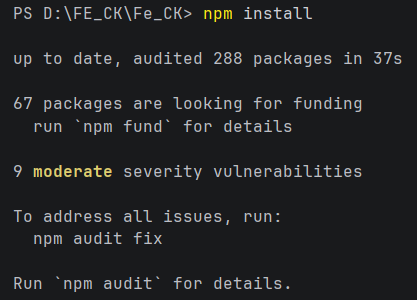
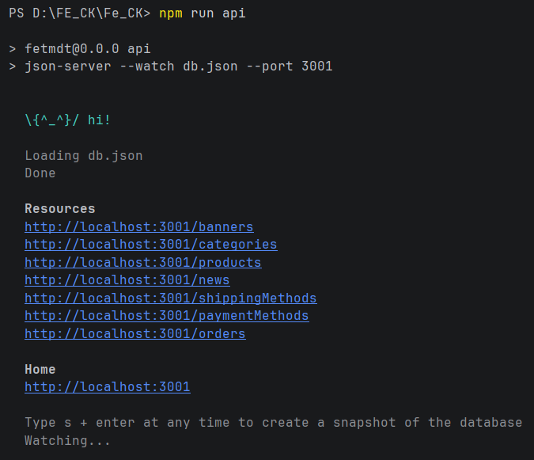
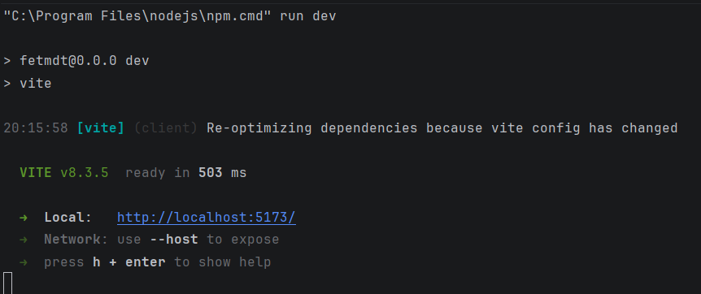
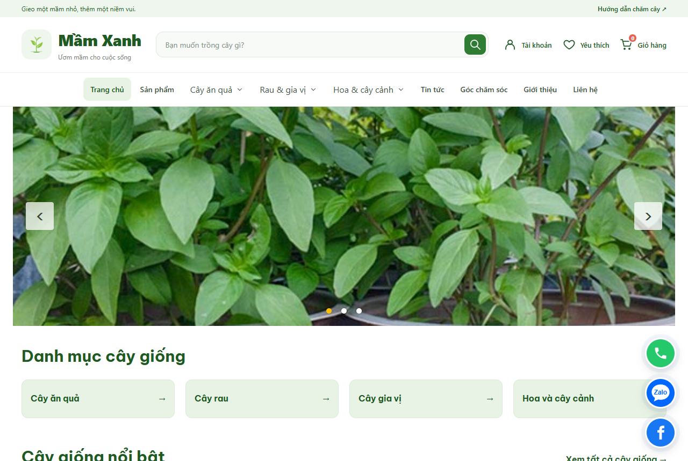

# 🌱 Mầm Xanh — Website bán cây giống

Đồ án môn **Lập trình Frontend**: website thương mại điện tử bán cây giống, viết bằng **React + TypeScript**. Dữ liệu được lấy từ một **fake API** chạy bằng JSON Server.

## 1. Giới thiệu đề tài

**Mầm Xanh** là website bán cây giống. Khách hàng có thể tìm cây, xem đặc điểm và cách chăm sóc, thêm vào giỏ hàng rồi đặt hàng. Người quản lý dùng trang quản lý demo để thêm, sửa, ẩn cây và tin tức, xem đơn và cập nhật thanh toán, giao hàng.

Các nhóm sản phẩm:

- Cây ăn quả: xoài, ổi, mít, chanh, bưởi.
- Cây rau và cây gia vị: cà chua, ớt, húng quế, bạc hà.
- Hoa và cây cảnh: hoa hồng, hoa giấy, trầu bà, lưỡi hổ.

Sản phẩm được bán theo **cây hoặc bầu giống**, kèm chiều cao, quy cách bầu và hướng dẫn chăm sóc.

## 2. Mục tiêu

- Vận dụng React để xây dựng giao diện từ các component có thể tái sử dụng.
- Thực hành sử dụng props, state và hooks để quản lý dữ liệu và tương tác.
- Xây dựng luồng mua hàng từ xem sản phẩm đến xác nhận đơn.
- Thực hành điều hướng trang, xử lý biểu mẫu và lưu dữ liệu trên trình duyệt.
- Thiết kế giao diện phù hợp với điện thoại, máy tính bảng và máy tính.
- Rèn luyện kỹ năng phân chia công việc và phối hợp xây dựng dự án nhóm.

## 3. Chức năng chính

### Phía khách hàng

- Trang chủ: banner, danh mục, cây nổi bật và tin mới.
- Danh sách cây: tìm theo tên, lọc danh mục và khoảng giá, sắp xếp giá, phân trang.
- Chi tiết cây: ảnh, giá, chiều cao, quy cách bầu, số lượng còn, hướng dẫn chăm sóc, chọn số lượng và thêm vào giỏ.
- Giỏ hàng lưu bằng `localStorage`: đổi số lượng, xóa cây, tính tiền.
- Danh sách cây yêu thích: bấm trái tim trên thẻ hoặc trang chi tiết, xem lại ở trang yêu thích, không cần tài khoản.
- Đặt hàng ba bước: nhập người nhận, chọn cách giao, chọn cách trả tiền (COD hoặc online mô phỏng).
- Trang xác nhận đơn: hiện mã đơn, cây đã mua, tổng tiền, trạng thái giao hàng và nút tải lại trạng thái.
- Tin tức, trang giới thiệu và trang liên hệ.

### Trang quản lý demo

- Quản lý cây giống: thêm, sửa, ẩn hoặc hiện cây.
- Quản lý tin tức: thêm, sửa, ẩn hoặc hiện bài viết.
- Quản lý đơn hàng: xem đơn, cập nhật trạng thái giao hàng, ghi nhận đã thu tiền COD, lùi một bước kèm lý do, sửa người nhận, hủy đơn.

Hướng dẫn thao tác chi tiết có ảnh nằm ở [docs/huong-dan-quan-ly.md](docs/huong-dan-quan-ly.md).

## 4. Phạm vi thực hiện

- Chỉ làm **frontend**, không viết backend riêng.
- Dữ liệu cây, tin, cách giao, cách trả tiền và đơn hàng được lưu trong `db.json`, phục vụ bởi JSON Server.
- Giỏ hàng, cây yêu thích và bản nháp đặt hàng được lưu trên trình duyệt.
- Thanh toán online chỉ là **mô phỏng** (thành công, thất bại hoặc hủy), không kết nối cổng thanh toán thật.
- Trang quản lý chưa có đăng nhập, mở trực tiếp bằng đường dẫn.

## 5. Công nghệ sử dụng

| Công nghệ / công cụ | Mục đích |
| --- | --- |
| React 19 | Xây dựng giao diện theo component |
| TypeScript | Kiểu dữ liệu cho sản phẩm, đơn hàng và các hàm xử lý |
| Vite 8 | Chạy môi trường phát triển và đóng gói |
| JSON Server 0.17.4 | Fake API đọc và ghi `db.json` |
| HTML, CSS | Bố cục, định dạng và giao diện responsive |
| Context API và hooks | Quản lý trạng thái giỏ hàng và cây yêu thích |
| localStorage, sessionStorage | Lưu giỏ hàng, cây yêu thích và bản nháp đặt hàng trên trình duyệt |
| ESLint | Kiểm tra mã nguồn |
| WebStorm | Viết mã và chạy dự án |
| Git, GitHub | Quản lý phiên bản và phối hợp làm việc nhóm |

## 6. Cấu trúc thư mục

```text
Fe_CK/
├── db.seed.json          # Dữ liệu gốc, dùng để khôi phục db.json
├── db.json               # Dữ liệu fake API đang dùng (tạo từ seed, không đưa lên Git)
├── docs/                 # Hướng dẫn quản lý và ảnh minh họa
├── public/
│   └── images/products/  # Ảnh cây giống
├── src/
│   ├── assets/           # Ảnh giao diện: logo, banner...
│   ├── components/       # Header, Footer, ProductCard, form, hộp thoại đơn hàng...
│   ├── context/          # Trạng thái giỏ hàng và cây yêu thích
│   ├── hooks/            # useCart, useFavorites, useApiData...
│   ├── pages/            # Các trang của website và trang quản lý
│   ├── services/         # Hàm gọi fake API
│   ├── style/            # File CSS theo từng trang, component
│   ├── types/            # Kiểu dữ liệu TypeScript
│   ├── utils/            # Định dạng tiền, kiểm tra biểu mẫu, trạng thái đơn...
│   ├── App.tsx           # Chọn trang theo đường dẫn
│   └── main.tsx
├── index.html
├── package.json
└── package-lock.json
```

## 7. Cài đặt và chạy demo

### 7.1 Yêu cầu

- **Node.js** phiên bản `20.19` trở lên hoặc `22.12` trở lên, vì Vite 8 cần các phiên bản này. Kiểm tra bằng `node -v`.
- npm đi kèm Node.js.
- WebStorm hoặc trình soạn thảo bất kỳ có Terminal.

### 7.2 Cài thư viện (làm một lần)

Mở Terminal tại thư mục dự án (thư mục có `package.json`) và chạy:

```bash
npm install
```



### 7.3 Tạo dữ liệu fake API (làm trước lần chạy đầu tiên)

`db.json` không có sẵn trong Git. Chép nó ra từ bản gốc `db.seed.json` bằng lệnh:

```bash
npm run db:reset
```

> ⚠️ Nếu bỏ qua bước này, JSON Server sẽ tự tạo một `db.json` mẫu (posts, comments) không phải dữ liệu của dự án, và website sẽ không có cây nào. Khi đó chỉ cần chạy lại `npm run db:reset`.

### 7.4 Chạy website bằng hai Terminal

**Terminal 1: chạy fake API** ở `http://localhost:3001`

```bash
npm run api
```



**Terminal 2: chạy React**

```bash
npm run dev
```



Mở địa chỉ Vite in ra, thường là `http://localhost:5173`. Cần giữ **cả hai** Terminal đang chạy trong suốt quá trình dùng website. Dừng server bằng `Ctrl + C`.



> Trong WebStorm, bấm dấu **+** trên thanh Terminal để mở Terminal thứ hai.

### 7.5 Khôi phục dữ liệu ban đầu

Sau khi thử thêm, sửa cây hoặc đặt nhiều đơn, có thể đưa dữ liệu về lúc đầu:

```bash
npm run db:reset
```

- Lệnh này chép đè `db.seed.json` lên `db.json`: cây, tin tức trở về ban đầu và **xóa toàn bộ đơn hàng**.
- Có thể chạy lệnh ngay cả khi `npm run api` đang chạy, JSON Server tự đọc lại file. Sau đó tải lại trang web (F5).
- Giỏ hàng và cây yêu thích nằm trong trình duyệt nên không bị xóa. Muốn xóa, vào DevTools (F12) → **Application** → **Local Storage** → xóa khóa `mam-xanh.cart.v1` (giỏ hàng) hoặc `mam-xanh.favorites.v1` (yêu thích).

### 7.6 Địa chỉ các trang

| Trang | Đường dẫn |
| --- | --- |
| Trang chủ | `/` |
| Danh sách cây | `/san-pham` |
| Chi tiết cây | `/san-pham/1` |
| Tin tức | `/tin-tuc` |
| Giới thiệu, liên hệ | `/gioi-thieu`, `/lien-he` |
| Giỏ hàng | `/gio-hang` |
| Cây yêu thích | `/yeu-thich` |
| Đặt hàng | `/thanh-toan` |
| Xác nhận đơn | `/don-hang/1/xac-nhan` |
| Quản lý cây giống | `/quan-ly/san-pham` |
| Quản lý tin tức | `/quan-ly/tin-tuc` |
| Quản lý đơn hàng | `/quan-ly/don-hang` |

### 7.7 Các lệnh khác

| Lệnh | Tác dụng |
| --- | --- |
| `npm run build` | Kiểm tra TypeScript và đóng gói vào thư mục `dist` |
| `npm run preview` | Xem thử bản đã đóng gói |
| `npm run lint` | Kiểm tra mã nguồn bằng ESLint |

### 7.8 Lỗi thường gặp

| Hiện tượng | Cách xử lý |
| --- | --- |
| Trang báo "Không kết nối được fake API" | Terminal 1 chưa chạy hoặc đã tắt. Chạy lại `npm run api`. |
| Website không có cây nào, API chỉ có `posts`, `comments` | Chưa tạo dữ liệu. Chạy `npm run db:reset`. |
| `npm run api` báo cổng 3001 đang bận | Đang có một Terminal khác chạy API. Tắt Terminal đó rồi chạy lại. |
| PowerShell báo "running scripts is disabled" | Dùng `npm.cmd` thay cho `npm`, hoặc chạy một lần `Set-ExecutionPolicy -Scope CurrentUser RemoteSigned`. |
| `npm run dev` báo phiên bản Node không hợp lệ | Cài Node.js bản LTS mới (22 hoặc 24), mở lại Terminal rồi chạy lại. |

## 8. Fake API và dữ liệu

React gọi API qua biến `VITE_API_URL`. Nếu không đặt biến này, mặc định là `http://localhost:3001`.

| Collection | Dùng cho | Số bản ghi ban đầu |
| --- | --- | --- |
| `categories` | Danh mục cây | 4 |
| `products` | Cây giống | 24 |
| `news` | Tin tức | 6 |
| `banners` | Banner trang chủ | 3 |
| `shippingMethods` | Cách giao: tiêu chuẩn 30.000 ₫, nhanh 50.000 ₫ | 2 |
| `paymentMethods` | Cách trả tiền: `COD`, `ONLINE_DEMO` | 2 |
| `orders` | Đơn hàng khách đặt | 0 |

Các endpoint chính:

| HTTP | Endpoint | Dùng cho |
| --- | --- | --- |
| GET | `/products`, `/products/:id` | Danh sách và chi tiết cây |
| POST, PATCH | `/products`, `/products/:id` | Thêm, sửa, ẩn cây (ẩn bằng `active: false`) |
| GET | `/news`, `/news/:id` | Tin tức |
| POST, PATCH | `/news`, `/news/:id` | Thêm, sửa, ẩn tin (`isPublished`) |
| GET | `/shippingMethods`, `/paymentMethods` | Chọn cách giao và cách trả tiền |
| POST | `/orders` | Đặt hàng |
| GET | `/orders`, `/orders/:id` | Trang quản lý đơn và trang xác nhận đơn |
| PATCH | `/orders/:id` | Cập nhật `deliveryStatus`, `paymentStatus`, người nhận |

Quy tắc đơn hàng:

- Tổng tiền = tiền hàng + phí giao.
- `paymentStatus`: `unpaid` hoặc `paid`. Đơn COD tạo ra là `unpaid`; online mô phỏng thành công là `paid`.
- `deliveryStatus`: `pending` → `preparing` → `shipping` → `delivered`, hoặc `cancelled`. Đơn đã giao hoặc đã hủy không chuyển tiếp được nữa.
- Đơn COD chỉ ghi nhận đã thu tiền sau khi giao xong.

> Giá, tồn kho, phí giao và đơn hàng đều là **dữ liệu giả định** phục vụ học tập.

## 9. Định hướng giao diện

- **Màu chủ đạo:** xanh lá, trắng và be.
- **Hình ảnh:** ưu tiên ảnh cây rõ nét, cùng tỷ lệ và có nguồn sử dụng phù hợp.
- **Thẻ sản phẩm:** làm rõ tên cây, giá bán, quy cách và thao tác mua hàng.
- **Trải nghiệm:** tìm kiếm dễ thấy, bộ lọc dễ dùng và giỏ hàng dễ truy cập.
- **Khả năng sử dụng:** biểu mẫu có nhãn, lỗi nhập liệu rõ ràng và nút bấm sử dụng được bằng bàn phím.

## 10. Hướng phát triển

- Kết nối backend và cơ sở dữ liệu thật thay cho JSON Server.
- Bổ sung đăng ký, đăng nhập và phân quyền cho trang quản lý.
- Bổ sung đánh giá sản phẩm và lịch sử mua hàng theo tài khoản.
- Tích hợp cổng thanh toán và đơn vị vận chuyển thật.

## 11. Thông tin nhóm

| Nội dung | Thông tin |
| --- | --- |
| Môn học | Lập trình Frontend |
| Tên đề tài | Thiết kế và xây dựng giao diện website bán cây giống bằng React |
| Tên nhóm | Nhóm 40 |
| Giảng viên hướng dẫn | Phan Đình Long |

### Thành viên và phân công

| Họ và tên | Mã sinh viên | Công việc phụ trách |
| --- | --- | --- |
| Phạm Văn Hoài Nam | 23130200 |  |
| Ngô Quang Khánh | 23130152 |  |
| Nguyễn Quang Thành | 23130307 |  |
---

Dự án phục vụ mục đích học tập. Thông tin sản phẩm, giá bán, tồn kho và đơn hàng trong bản demo là dữ liệu mẫu.
