# Hướng dẫn sử dụng trang quản lý demo

Tài liệu hướng dẫn người quản lý cửa hàng Mầm Xanh thao tác với cây giống, tin tức và đơn hàng. Phần này dùng cho mục **5. Trang quản lý demo** trong `HDSD_Mam_Xanh.pdf`.

> Trước khi làm theo, hãy chạy website như mục **7. Cài đặt và chạy demo** trong [README](../README.md): `npm run db:reset`, `npm run api` và `npm run dev`. Các địa chỉ dưới đây tính từ `http://localhost:5173`.

| Trang | Đường dẫn |
| --- | --- |
| Quản lý cây giống | `/quan-ly/san-pham` |
| Quản lý tin tức | `/quan-ly/tin-tuc` |
| Quản lý đơn hàng | `/quan-ly/don-hang` |

Trang quản lý demo chưa có đăng nhập, gõ thẳng đường dẫn vào thanh địa chỉ để mở. Mọi thay đổi được lưu vào `db.json`. Muốn đưa dữ liệu về ban đầu thì chạy `npm run db:reset`.

---

## 1. Quản lý cây giống

### 1.1 Xem danh sách cây

Mở `/quan-ly/san-pham`.

- Bốn ô đầu trang cho biết: tổng số cây, số cây đang hiển thị, số cây đã ẩn và số cây hết hàng.
- Bảng liệt kê mã, tên, danh mục, giá, tồn kho mẫu và trạng thái của từng cây, 6 cây mỗi trang.
- Lọc nhanh bằng ô **Tìm theo tên**, **Danh mục** và **Trạng thái** (Tất cả, Đang hiển thị, Đã ẩn). Bấm **Xóa lọc** để bỏ hết điều kiện lọc.

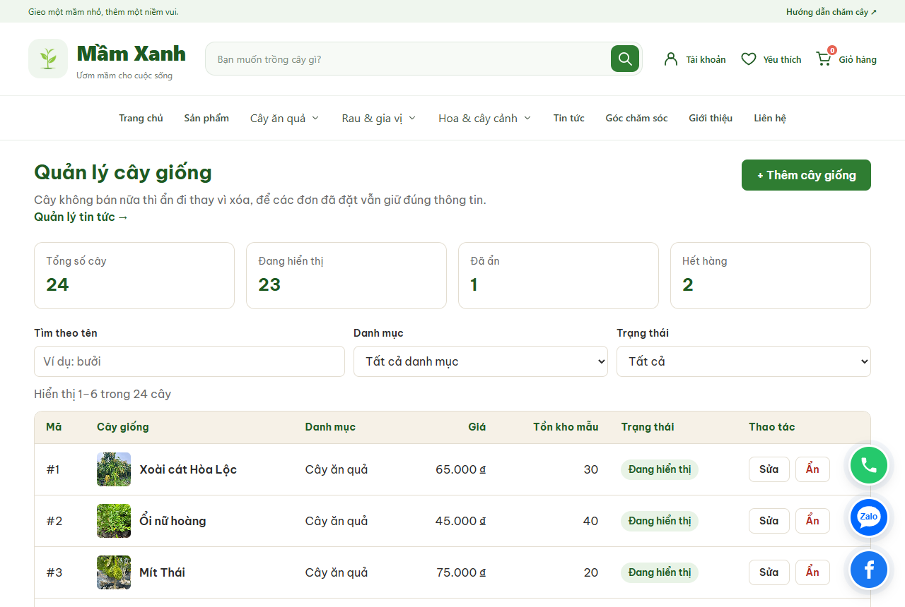

### 1.2 Thêm cây giống mới

1. Bấm **+ Thêm cây giống** ở góc phải.
2. Điền biểu mẫu:

   | Ô | Quy tắc |
   | --- | --- |
   | Tên cây | 2–80 ký tự, không trùng tên cây khác |
   | Danh mục | Bắt buộc chọn |
   | Giá (₫) | Số nguyên từ 1.000 đến 10.000.000, gõ `85000` hoặc `85.000` đều được |
   | Tồn kho mẫu (cây) | Số nguyên từ 0 đến 10.000 |
   | Chiều cao (cm) | Số nguyên từ 1 đến 500 |
   | Quy cách bầu | Bầu ươm (cây ăn quả, hoa) hoặc Bầu nhỏ (rau, gia vị) |
   | Đường dẫn ảnh | Bắt đầu bằng `/` hoặc `http(s)://`, ví dụ `/images/products/xoai-cat.jpg` |
   | Mô tả | Ít nhất 10 ký tự |
   | Hướng dẫn chăm sóc | Ít nhất 10 ký tự, viết theo mẫu `Ánh sáng: … Tưới nước: … Chăm sóc: …` |
   | Hiển thị cho khách | Bỏ tick nếu muốn tạo cây nhưng chưa bán |

3. Bấm **Lưu**. Ô nào sai sẽ báo lỗi màu đỏ ngay dưới ô đó.
4. Lưu thành công thì trang báo `Đã thêm "…" với mã #…`, và cây mới được tô sáng ở trang cuối của bảng.

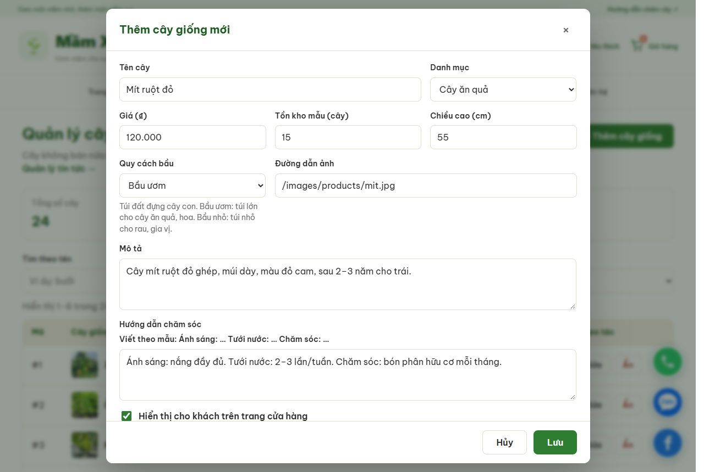

### 1.3 Sửa thông tin cây

1. Bấm **Sửa** ở dòng cây cần sửa.
2. Biểu mẫu mở ra với dữ liệu hiện tại. Sửa các ô cần thiết rồi bấm **Lưu**.
3. Trang báo `Đã lưu thay đổi của "…"`. Khách sẽ thấy giá và thông tin mới khi tải lại trang.

### 1.4 Ẩn hoặc hiện lại cây

Cửa hàng **không xóa** cây, để các đơn đã đặt vẫn giữ đúng tên và giá lúc mua.

1. Bấm **Ẩn** ở dòng cây không bán nữa. Trạng thái chuyển thành **Đã ẩn**, dòng đó mờ đi.
2. Khách sẽ không thấy cây này trong danh sách, trang chủ hay trang chi tiết nữa.
3. Muốn bán lại, bấm **Hiện**.

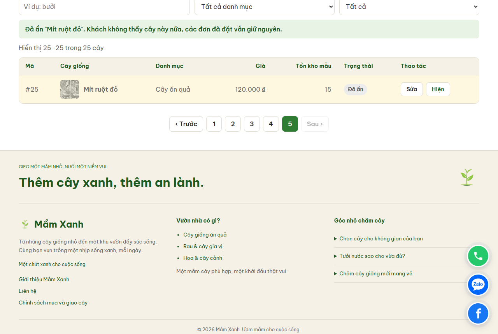

---

## 2. Quản lý tin tức

### 2.1 Xem danh sách tin

Mở `/quan-ly/tin-tuc`, hoặc bấm **Quản lý tin tức →** ở trang quản lý cây. Bảng hiện ảnh, tiêu đề, ngày đăng (mới nhất ở trên) và trạng thái **Đã xuất bản** hoặc **Đã ẩn**.

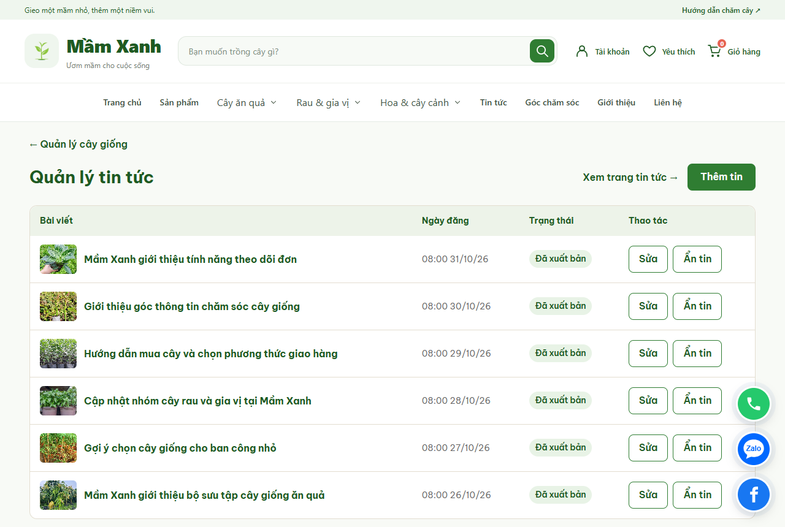

### 2.2 Thêm hoặc sửa tin

1. Bấm **Thêm tin**, hoặc **Sửa** ở dòng tin cần sửa.
2. Điền **Tiêu đề**, **Tóm tắt**, **Đường dẫn ảnh bìa**, **Ngày đăng (giờ Việt Nam)** và **Nội dung bài viết**. Tất cả đều bắt buộc.
3. Tick **Xuất bản bài viết** nếu muốn khách đọc được ngay.
4. Bấm **Lưu bài viết**. Trang báo `Đã thêm bài "…"` hoặc `Đã cập nhật bài "…"`.

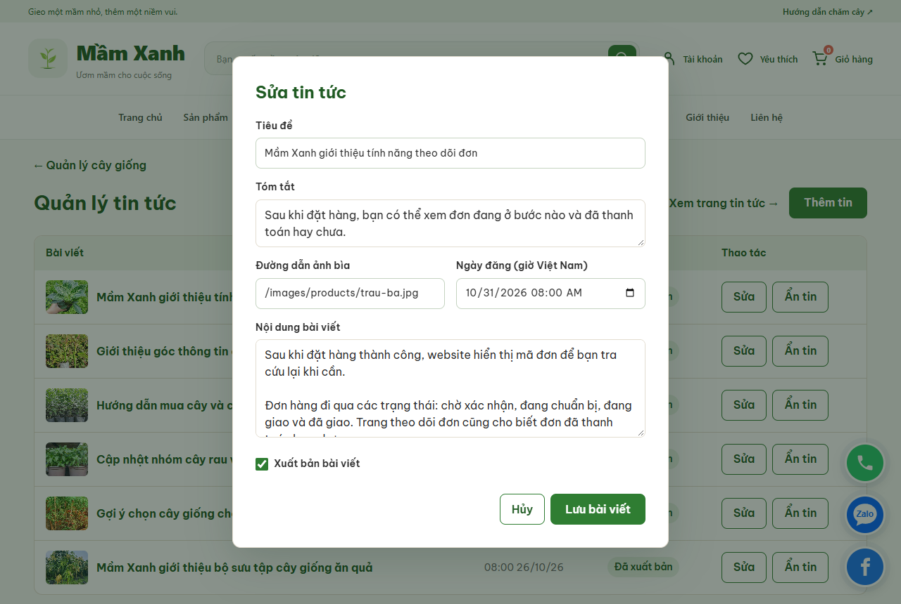

### 2.3 Ẩn hoặc hiện tin

Bấm **Ẩn tin** để gỡ bài khỏi trang `/tin-tuc`, hoặc **Hiện tin** để đăng lại. Bài bị ẩn vẫn nằm trong bảng quản lý để sửa sau.

---

## 3. Quản lý đơn hàng

### 3.1 Chuẩn bị đơn để thử

Dữ liệu ban đầu chưa có đơn nào. Hãy đặt thử ở phía khách trước:

- **Đơn COD:** thêm cây vào giỏ → mở giỏ hàng, bấm **Nhập thông tin người nhận** → điền rồi bấm **Lưu thông tin người nhận** → chọn cách giao, bấm **Tiếp tục thanh toán** → chọn **Thanh toán khi nhận hàng** → **Đặt hàng**.
- **Đơn online:** làm tương tự nhưng chọn **Thanh toán online (mô phỏng)**, bấm **Thành công** trong hộp mô phỏng, rồi bấm **Đặt hàng**.

Chọn **Thất bại** hoặc **Hủy** trong hộp mô phỏng sẽ không tạo đơn. Giỏ hàng vẫn được giữ để khách thử lại.

### 3.2 Xem danh sách đơn

Mở `/quan-ly/don-hang`. Đơn mới nhất nằm trên cùng. Mỗi dòng có mã đơn và thời gian đặt, khách hàng, sản phẩm, trạng thái thanh toán, trạng thái giao hàng và tổng tiền. Bấm **Tải lại đơn** để lấy đơn khách vừa đặt.

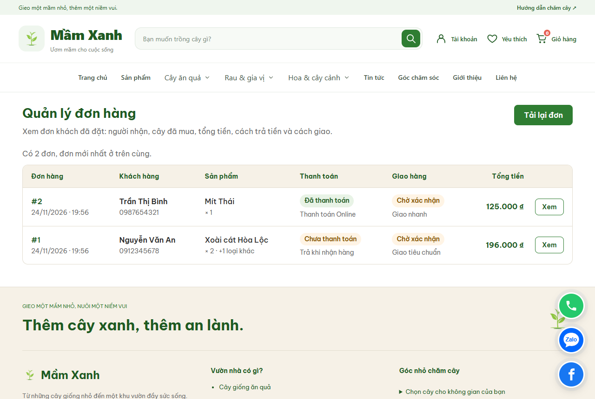

### 3.3 Xem chi tiết đơn

Bấm **Xem chi tiết** ở dòng đơn. Hộp chi tiết hiện:

- Trạng thái thanh toán và giao hàng, kèm thanh tiến trình 4 bước có giờ cập nhật.
- Người nhận: họ tên, điện thoại, khu vực, địa chỉ, ghi chú.
- Cách trả tiền, cách giao, thời gian dự kiến và phí giao.
- Danh sách cây, tiền hàng, phí giao và tổng cộng.
- **Nhật ký trạng thái**: các lần đổi trạng thái kèm thời gian, bấm vào để mở xem.

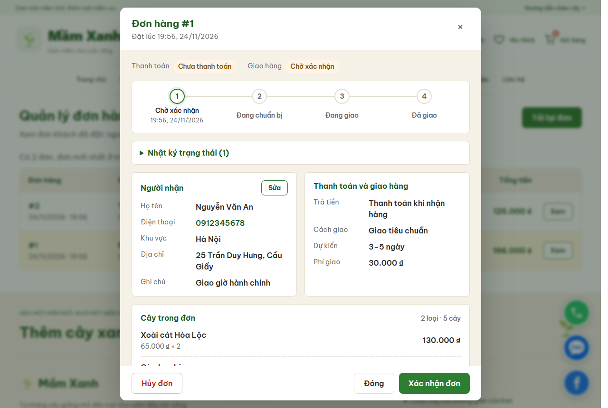

### 3.4 Cập nhật trạng thái giao hàng

Đơn đi theo thứ tự sau. Nút chính ở góc phải dưới hộp chi tiết luôn là bước tiếp theo:

| Trạng thái hiện tại | Nút bấm | Trạng thái mới |
| --- | --- | --- |
| Chờ xác nhận | **Xác nhận đơn** | Đang chuẩn bị |
| Đang chuẩn bị | **Bắt đầu giao hàng** | Đang giao |
| Đang giao | **Xác nhận đã giao** | Đã giao |

Sau mỗi lần bấm, hộp báo `Đơn #… đã chuyển sang "…"`, và bảng đơn cập nhật ngay.

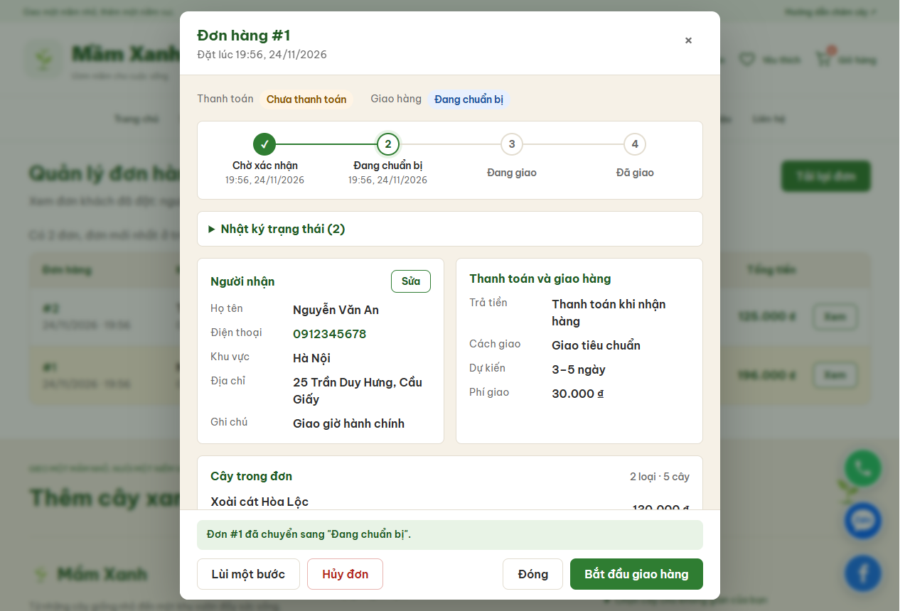

Khách xem lại đơn ở trang xác nhận `/don-hang/<mã đơn>/xac-nhan`, bấm **Tải lại trạng thái** để thấy trạng thái mới.

### 3.5 Ghi nhận đã thu tiền COD

Với đơn **COD** đã chuyển sang **Đã giao**, hộp chi tiết có thêm nút **Đã thu …₫**. Bấm nút này sau khi nhận đủ tiền mặt, trạng thái thanh toán sẽ chuyển thành **Đã thanh toán**.

Đơn online mô phỏng đã thanh toán từ lúc đặt nên không có nút này.

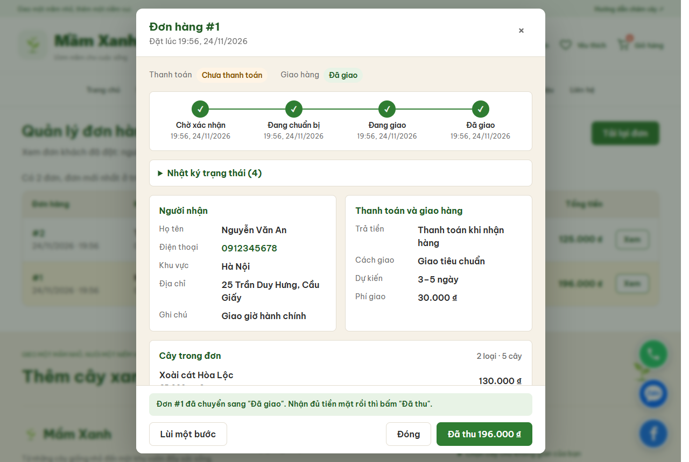

### 3.6 Lùi một bước kèm lý do

Dùng khi bấm nhầm hoặc cần làm lại một bước, ví dụ đóng gói sai phải đóng gói lại.

1. Bấm **Lùi một bước**.
2. Nhập lý do (bắt buộc, tối đa 200 ký tự), rồi bấm **Lùi lại**.
3. Đơn quay về trạng thái trước đó. Lý do được ghi vào **Nhật ký trạng thái**.

Đơn đã giao **và** đã thanh toán thì không lùi được nữa.

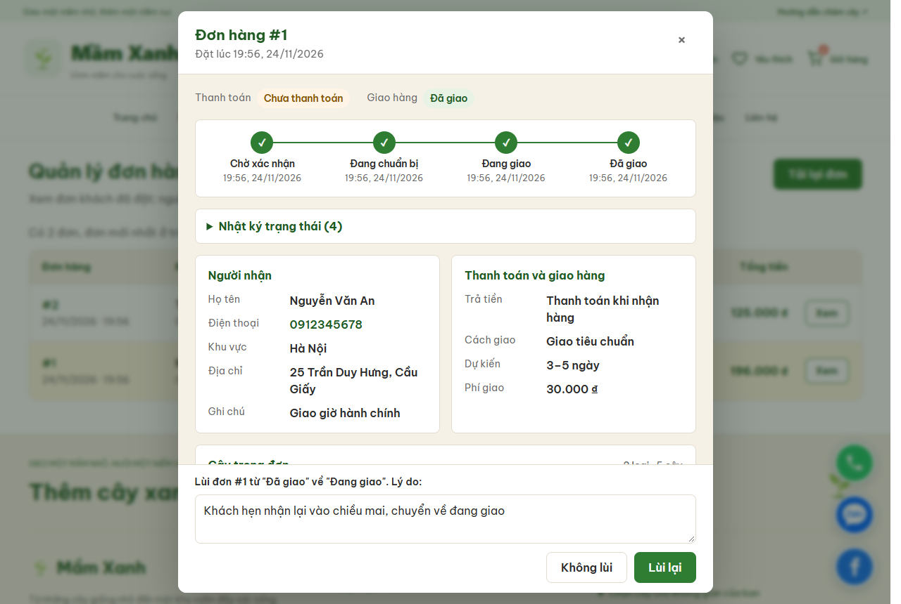

### 3.7 Sửa người nhận

Khi đơn chưa giao và chưa hủy, khung **Người nhận** có nút **Sửa**.

1. Bấm **Sửa**, đổi họ tên, điện thoại, khu vực (chọn tỉnh/thành phố trong danh sách), địa chỉ hoặc ghi chú.
2. Bấm **Lưu người nhận**. Thông tin sai sẽ báo lỗi ngay dưới ô.

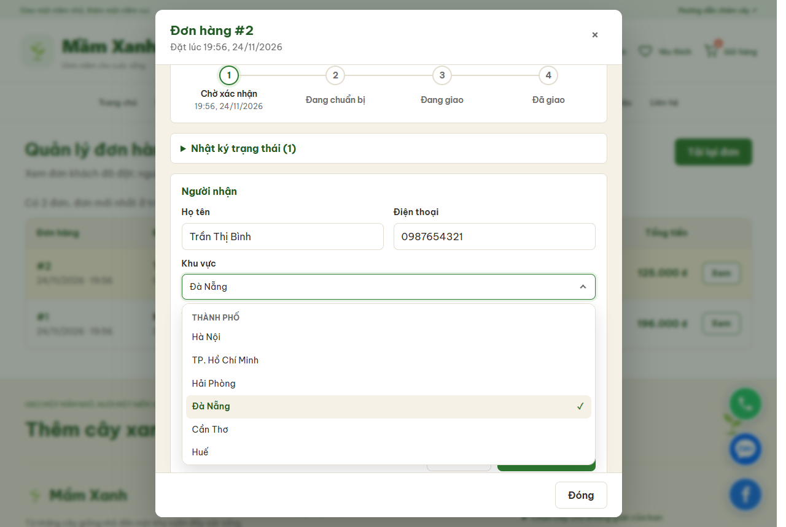

### 3.8 Hủy đơn

1. Bấm **Hủy đơn** (chỉ có khi đơn chưa giao).
2. Đọc thông báo xác nhận. Nếu đơn đã trả tiền online, thông báo sẽ nhắc cần hoàn tiền cho khách.
3. Bấm **Có, hủy đơn** để hủy, hoặc **Không hủy** để quay lại.

Đơn đã hủy **không** chuyển lại được.

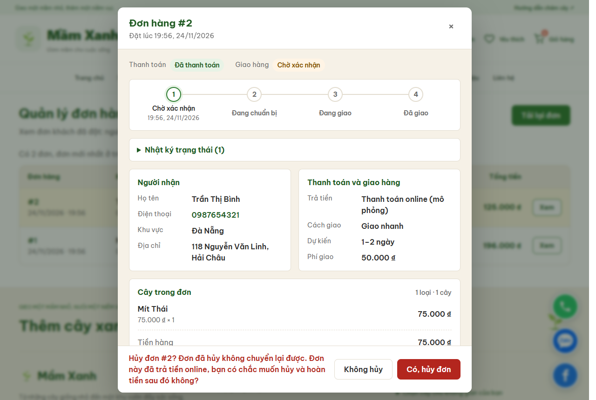

---

## 4. Tóm tắt quy tắc

- Cây giống và tin tức không bị xóa, chỉ ẩn hoặc hiện.
- Trạng thái giao hàng: Chờ xác nhận → Đang chuẩn bị → Đang giao → Đã giao. Có thể hủy khi đơn chưa giao.
- Đơn COD chỉ ghi nhận đã thu tiền sau khi đã giao.
- Mọi lần đổi trạng thái đều được ghi vào nhật ký của đơn.
- Giá, tồn kho, phí giao và đơn hàng là dữ liệu giả định. Thanh toán online chỉ là mô phỏng.
